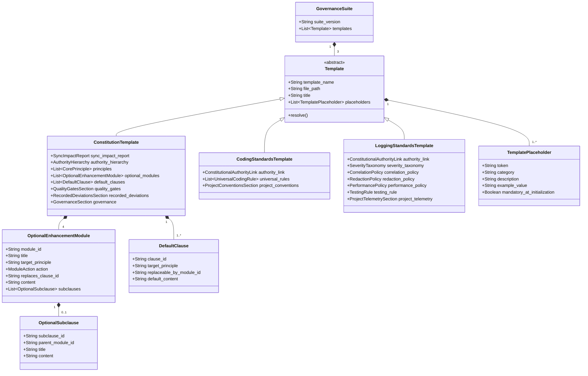
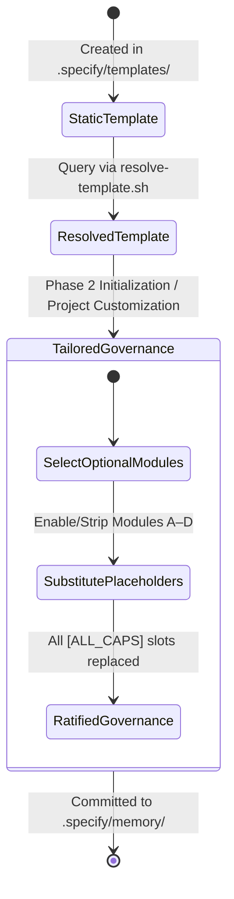

# Data Model: Base Governance Suite & Templates

**Feature**: `001-base-governance-templates`  
**Status**: Completed  
**Artifact**: `specs/001-base-governance-templates/data-model.md`

## Overview

This document specifies the conceptual entities, fields, relationships, validation constraints, and lifecycle state transitions for the Base Governance Suite templates and optional enhancement modules.

---

## Entity Relationship Diagram

---

## Entity Specifications

### 1. `ConstitutionTemplate`
Represents the supreme governance template for a repository.

- **File Path**: `.specify/templates/constitution-template.md`
- **Resolution Identifier**: `constitution-template`
- **Fields**:
  - `sync_impact_report`: Markdown/HTML comment capturing `Version Change`, `Modified Principles`, `Modified Sections`, and `Rationale`.
  - `authority_hierarchy`: 3-tier ordered hierarchy with placeholders: `[PRIMARY_SOURCE]`, `[SECONDARY_SOURCE]`, `[TERTIARY_SOURCE]`.
  - `core_principles`: Ordered list of 7 principles (I through VII):
    1. *I. Evidence Over Invention & Bounded Investigation*
    2. *II. Two-Tier Failure Model & Fail Closed on Required State*
    3. *III. Behavioral, Value-Driven Testing & Deterministic Execution*
    4. *IV. Single Authoritative State, Enforced Boundaries & Safe Concurrency*
    5. *V. Centralized Dependencies & Protected Toolchain Gate*
    6. *VI. Bounded Resources & Verify-Before-Destroy*
    7. *VII. Code Hygiene, Ubiquitous Language & Safe Logging*
  - `quality_gates`: Spec Kit workflow rules, pre-PR verification commands with `[ACCEPTANCE_GATE_COMMANDS]`, PR size (~500 LOC), and merge authority.
  - `recorded_deviations`: Table or list template requiring: Principle violated, Ratifying authority, Rationale, Compensating control, and Gap link.
  - `governance`: Document hierarchy (linking companion standards), 6-tier Precedence Order, Amendment & Versioning rules.
  - `footer`: Standard metadata footer: `**Version**: 1.0.0 | **Ratified**: [YYYY-MM-DD] | **Last Amended**: [YYYY-MM-DD]`.

### 2. `OptionalEnhancementModule`
A modular rule block embedded inline within `constitution-template.md` enclosed by machine-parseable comment delimiters.

- **Fields**:
  - `module_id`: String enum `{"MODULE-A", "MODULE-B", "MODULE-C", "MODULE-D"}`.
  - `action`: String enum `{"ADD", "REPLACE"}`.
  - `target_principle`: Target principle identifier (`"Principle I"`, `"Principle III"`, `"Principle IV"`, `"Principle V"`).
  - `title`: Human-readable module title.
  - `replaces_clause_id`: Identifier of the default clause being replaced (required when `action == REPLACE`, e.g., `"PLAN-JUSTIFICATION-AND-SKIP-ALLOWLIST"` for `MODULE-B`).
  - `content`: Exact markdown text of the rule.
  - `subclauses`: Optional list of `OptionalSubclause` entities.

#### Inventory of Optional Modules:
| Module ID | Target Principle | Action | Replaces Clause | Title |
|-----------|------------------|--------|-----------------|-------|
| `MODULE-A` | Principle I | `ADD` | *None* | In-Code Open Question Pointers |
| `MODULE-B` | Principle III | `REPLACE` | `PLAN-JUSTIFICATION-AND-SKIP-ALLOWLIST` | Strict 100% Branch Coverage Profile |
| `MODULE-C` | Principle IV | `ADD` | *None* | Table-Driven Dispatch |
| `MODULE-D` | Principle V | `ADD` | *None* | Regulated / Certified Systems |

### 3. `OptionalSubclause`
A nested sub-option within an Optional Enhancement Module.

- **Fields**:
  - `subclause_id`: String (e.g., `"MODULE-D-AOT-TRIM"`).
  - `parent_module_id`: String (`"MODULE-D"`).
  - `action`: String (`"OPTIONAL-INCLUSION"`).
  - `title`: String (`"AOT / Trim-Safe Shared Libraries"`).
  - `content`: `[Optional: Shared libraries consumed by constrained environments SHOULD be AOT/trim-safe, isolating any untrimmable code to the narrowest scope with documented justification.]`

### 4. `DefaultClause`
A baseline rule block inside a principle that can be replaced by an optional enhancement module.

- **Fields**:
  - `clause_id`: String (e.g., `"PLAN-JUSTIFICATION-AND-SKIP-ALLOWLIST"`).
  - `target_principle`: String (`"Principle III"`).
  - `replaceable_by_module_id`: String (`"MODULE-B"`).
  - `content`: Baseline text of the Plan Justification & Skip Allowlist rule with 5 skip exemptions.

### 5. `CodingStandardsTemplate`
Operationalizes the Constitution into concrete, language-agnostic daily engineering conventions.

- **File Path**: `.specify/templates/coding-standards-template.md`
- **Resolution Identifier**: `coding-standards-template`
- **Fields**:
  - `authority_link`: Explicit reference declaring that `constitution.md` takes precedence.
  - `universal_rules`:
    - *Boundary Isolation*: Domain logic strictly isolated from wire types and I/O; enforced at compile time.
    - *Two-Tier Error Handling*: Recoverable errors returned as explicit typed results; defects halt/restart immediately; catch blocks require explicit disposition.
    - *Concurrency & Immutable Snapshots*: Lock discipline (no callbacks/I/O under lock), side-effects queued, state exposed exclusively via immutable snapshots (`record` / `record struct`).
    - *Disambiguated Identifiers*: Pair-passed IDs must use distinct value types (`readonly record struct`).
    - *Bounded Inputs & Resource Protection*: Explicit ceiling validation before allocation, streaming for large payloads, cancellation tokens on I/O.
    - *Verify-Before-Destroy*: Destructive operations guarded by pre-flight checks and explicit confirmation.
    - *Hostile Boundary & Unit Testing*: Encapsulation preserved (no visibility widening for tests), time injected, deterministic execution, hostile-input coverage.
    - *Code Hygiene & Comments*: Zero warnings, present-tense "why" comments, no history narration, pointer-only tags for open questions (`// OPEN-QUESTION: OQ-XXX`).
  - `project_conventions`: Clearly delineated sections for language, build tooling, linters, naming conventions, error types, and test runners containing `[ALL_CAPS_IDENTIFIER]` placeholders with non-binding exemplary commentary (e.g., standard .NET conventions).

### 6. `LoggingStandardsTemplate`
Operationalizes Constitutional Principles II and VII into concrete observability and telemetry standards.

- **File Path**: `.specify/templates/logging-standards-template.md`
- **Resolution Identifier**: `logging-standards-template`
- **Fields**:
  - `authority_link`: Explicit reference declaring that `constitution.md` takes precedence.
  - `severity_taxonomy`:
    - `CRITICAL`: System restarting; requires restart reason and exception details.
    - `WARN`: Recoverable boundary rejection or failed-but-continuing operation worth monitoring; never hidden in `DEBUG`.
    - `INFO`: Significant lifecycle milestones reading like an audit trail; states outcome, not diagnostic data. Significant actions log both attempt and result. Infrequent startup/shutdown in verbose layers logs at `INFO`.
    - `DEBUG`: Application's interpretation of state and diagnostic reasoning prior to a milestone; "engineer's working notes"; never leaks into `INFO`.
    - `TRACE`: Mechanical entry/exit on every function and return path. Complex objects use `ToString()` or dedicated cheap helpers. External library calls do not emit `TRACE`.
  - `correlation_policy`: Ambient scope propagation (`session_id`, `event_id`); call-site parameter passing or manual logging forbidden.
  - `redaction_policy`: Strict prohibition of passwords, tokens, API keys, full credit cards, SSNs, government IDs, and raw PII. Permitted internal IDs: GUIDs, database IDs, usernames.
  - `performance_policy`: Guard expensive log arguments with level checks; sample or aggregate sustained high-frequency events (>100/sec).
  - `testing_rule`: Unit tests strictly prohibited from asserting on log text or operator display strings.
  - `project_telemetry`: Delineated sections for logging framework, sinks/transports, redaction mechanism, and retention policy containing `[ALL_CAPS_IDENTIFIER]` placeholders.

### 7. `TemplatePlaceholder`
Standardized placeholder tokens requiring substitution when a project initializes its governance documents.

- **Syntax Rule**: Token format must strictly match `\[[A-Z0-9_]+\]` or `\[YYYY-MM-DD\]`.
- **Fields**: `token`, `target_template`, `category`, `description`, `example_value`, `mandatory_at_initialization`.

---

## State Transitions & Template Lifecycle

