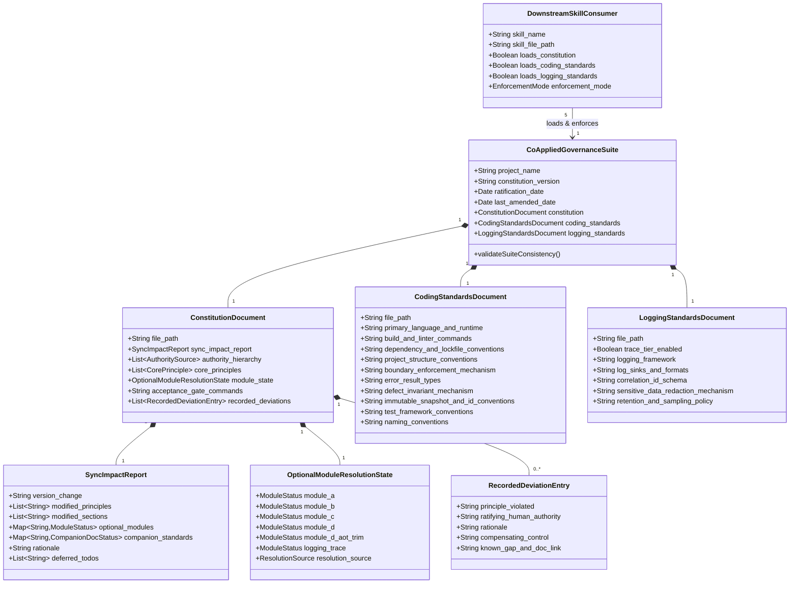
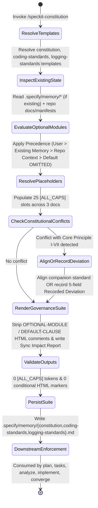

# Data Model: Co-Applied Governance & Constitutional Merge

**Feature**: `002-co-applied-governance-merge`  
**Status**: Completed  
**Artifact**: `specs/002-co-applied-governance-merge/data-model.md`

## Overview

This document defines the conceptual entities, attributes, relationships, validation rules, and state transitions for the Co-Applied Governance Suite, the Constitutional & Standards Merge Workflow (`speckit-constitution`), Optional Enhancement Module Resolution, Recorded Deviations, and Downstream Skill Governance Integration.

---

## Entity Relationship Diagram

---

## Entity Specifications

### 1. `CoAppliedGovernanceSuite`
The triad of linked, mutually consistent governance documents persisted in `.specify/memory/`.

- **Canonical Paths**:
  - `.specify/memory/constitution.md` (Supreme governance authority)
  - `.specify/memory/coding-standards.md` (Stack- and language-specific implementation conventions)
  - `.specify/memory/logging-standards.md` (Observability, severity taxonomy, and telemetry configuration)
- **Shared Identity Constraint**:
  - `project_name` (`[PROJECT_NAME]`): Non-empty string; MUST be identical across the H1 headers (`# <project_name> Constitution`, `# <project_name> Coding Standards`, `# <project_name> Logging Standards`) and inline project references in all three files.
- **Validation Rules**:
  - All three files MUST exist and be non-empty after `/speckit-constitution` completes.
  - Zero unresolved `[ALL_CAPS_IDENTIFIER]` tokens (`\[[A-Z0-9_]+\]`) may remain in any of the three files.
  - Zero raw template conditional HTML comment blocks (`<!-- OPTIONAL-MODULE`, `<!-- /OPTIONAL-MODULE`, `<!-- OPTIONAL-SUBCLAUSE`, `<!-- /OPTIONAL-SUBCLAUSE`, `<!-- DEFAULT-CLAUSE`, `<!-- /DEFAULT-CLAUSE`) may remain in `.specify/memory/constitution.md`.

---

### 2. `OptionalModuleResolutionState`
Captures the activation state for each optional rule block during constitutional merge and template rendering.

- **Fields**:
  - `module_a` (*In-Code Open Question Pointers*, Target: Principle I, Action: `ADD`): Enum `{"ENABLED", "OMITTED"}`.
  - `module_b` (*Strict 100% Branch Coverage Profile*, Target: Principle III, Action: `REPLACE`, Replaces: `PLAN-JUSTIFICATION-AND-SKIP-ALLOWLIST`): Enum `{"ENABLED", "OMITTED"}`.
  - `module_c` (*Table-Driven Dispatch*, Target: Principle IV, Action: `ADD`): Enum `{"ENABLED", "OMITTED"}`.
  - `module_d` (*Regulated / Certified Systems*, Target: Principle V, Action: `ADD`): Enum `{"ENABLED", "OMITTED"}`.
  - `module_d_aot_trim` (*AOT / Trim-Safe Shared Libraries*, Parent: `MODULE-D`, Action: `OPTIONAL-INCLUSION`): Enum `{"ENABLED", "OMITTED"}`.
  - `logging_trace` (*Mechanical TRACE Entry/Exit Logging*, Target: `logging-standards.md`): Enum `{"ENABLED", "OMITTED"}`.
- **Constraints & Invariants**:
  - **Precedence**: Determined in strict order: `(1) Explicit User Input -> (2) Existing Ratified .specify/memory/constitution.md State -> (3) Repository Context Inference (defaulting unrequested/unevidenced modules to OMITTED)`.
  - **Mutual Exclusivity (`module_b`)**:
    - When `module_b == ENABLED`, Principle III MUST contain `- **100% Branch Coverage Gate**:` and MUST NOT contain `- **Plan Justification & Skip Allowlist**:`.
    - When `module_b == OMITTED`, Principle III MUST contain `- **Plan Justification & Skip Allowlist**:` and MUST NOT contain `- **100% Branch Coverage Gate**:`.
  - **Parent-Child Dependency (`module_d_aot_trim`)**:
    - If `module_d == OMITTED`, `module_d_aot_trim` MUST be `OMITTED`.
    - If `module_d == ENABLED` and `module_d_aot_trim == ENABLED`, the surrounding `[Optional: ...]` brackets MUST be unwrapped so the sentence reads as normative prose (`Shared libraries consumed by constrained environments SHOULD be AOT/trim-safe...`).

---

### 3. `PlaceholderValueResolution`
Represents the 25 standardized placeholder slots across the three templates and their resolved project values.

- **Slot Distribution**:
  - **Constitution (`constitution-template.md`) — 8 slots**:
    1. `[PROJECT_NAME]` (required, synchronized across suite)
    2. `[PRIMARY_SOURCE]` (required)
    3. `[SECONDARY_SOURCE]` (required)
    4. `[TERTIARY_SOURCE]` (required)
    5. `[ACCEPTANCE_GATE_COMMANDS]` (required)
    6. `[CONSTITUTION_VERSION]` (required, regex: `^[0-9]+\.[0-9]+\.[0-9]+$`)
    7. `[RATIFICATION_DATE]` (required, regex: `^[0-9]{4}-[0-9]{2}-[0-9]{2}$`)
    8. `[LAST_AMENDED_DATE]` (required, regex: `^[0-9]{4}-[0-9]{2}-[0-9]{2}$`)
  - **Coding Standards (`coding-standards-template.md`) — 11 slots**:
    1. `[PROJECT_NAME]` (required, synchronized across suite)
    2. `[PRIMARY_LANGUAGE_AND_RUNTIME]` (required)
    3. `[BUILD_AND_LINTER_COMMANDS]` (required)
    4. `[DEPENDENCY_AND_LOCKFILE_CONVENTIONS]` (required)
    5. `[PROJECT_STRUCTURE_CONVENTIONS]` (required)
    6. `[BOUNDARY_ENFORCEMENT_MECHANISM]` (required)
    7. `[ERROR_RESULT_TYPES]` (required)
    8. `[DEFECT_INVARIANT_MECHANISM]` (required)
    9. `[IMMUTABLE_SNAPSHOT_AND_ID_CONVENTIONS]` (required)
    10. `[TEST_FRAMEWORK_CONVENTIONS]` (required)
    11. `[NAMING_CONVENTIONS]` (required)
  - **Logging Standards (`logging-standards-template.md`) — 6 slots**:
    1. `[PROJECT_NAME]` (required, synchronized across suite)
    2. `[LOGGING_FRAMEWORK]` (required)
    3. `[LOG_SINKS_AND_FORMATS]` (required)
    4. `[CORRELATION_ID_SCHEMA]` (required)
    5. `[SENSITIVE_DATA_REDACTION_MECHANISM]` (required)
    6. `[RETENTION_AND_SAMPLING_POLICY]` (required; includes explicit statement of whether optional `TRACE` logging is enabled or disabled)
- **Merge Precedence**:
  1. Explicit user input in current session
  2. Existing ratified value in `.specify/memory/{constitution,coding-standards,logging-standards}.md`
  3. Concrete repository evidence (`README.md`, `Architecture.md`, `ROADMAP.md`, `CodingStandards.md`, `docs/logging.md`, manifests, scripts)
  4. Explicit `TODO(<FIELD_NAME>): <explanation>` marker (if genuinely unresolvable; never a raw `[ALL_CAPS_IDENTIFIER]` token or fabricated guess).

---

### 4. `SyncImpactReport`
The structured HTML comment block at the top of `.specify/memory/constitution.md` summarizing the latest governance operation.

- **Fields**:
  - `version_change`: Format `<old_version> -> <new_version>` (e.g., `0.0.0 -> 1.0.0` or `1.0.0 -> 1.0.1`).
  - `modified_principles`: Summary of added, updated, or unchanged Core Principles I–VII.
  - `modified_sections`: Summary of sections modified in `constitution.md`.
  - `optional_modules`: Explicit activation status of `MODULE-A`, `MODULE-B`, `MODULE-C`, `MODULE-D` (and `MODULE-D-AOT-TRIM`), plus `TRACE` logging status.
  - `companion_standards`: Status of `.specify/memory/coding-standards.md` and `.specify/memory/logging-standards.md` (`created`, `updated`, or `unchanged`).
  - `rationale`: Concise explanation of why the governance change was made.
  - `deferred_todos`: Optional list of any `TODO(<FIELD_NAME>)` items requiring human follow-up.
- **Constraint**:
  - Must only record the *latest* amendment (do not accumulate historical amendment logs inside the file).

---

### 5. `RecordedDeviationEntry`
A structured exception record under `## Recorded Deviations` in `.specify/memory/constitution.md` required whenever a project ratifies a deviation from a Core Principle.

- **Mandatory Fields (all 5 required)**:
  1. `principle_violated`: Exact Core Principle numeral and title (e.g., `Principle II — Fail Closed on Required State`).
  2. `ratifying_human_authority`: Name/role of the human owner who approved the deviation (AI agents cannot self-ratify deviations).
  3. `rationale`: Why strict adherence is currently infeasible or inappropriate.
  4. `compensating_control`: The alternative safeguard mitigating the risk.
  5. `known_gap_and_doc_link`: Link to the tracking entry in `reference/open-questions.md` or component architecture doc.

---

### 6. `DownstreamSkillConsumer`
The five Spec Kit lifecycle skills that load and enforce the Co-Applied Governance Suite.

| Skill Name | File Path | Governance Loading Behavior | Enforcement Responsibility |
|------------|-----------|-----------------------------|----------------------------|
| `speckit-plan` | `.agents/skills/speckit-plan/SKILL.md` | Loads `constitution.md` + `coding-standards.md` + `logging-standards.md` (if present) | Populates `Technical Context` defaults; evaluates `Constitution Check` gate (including Principle III test justification and coding/logging alignment). |
| `speckit-tasks` | `.agents/skills/speckit-tasks/SKILL.md` | Loads `constitution.md` + `coding-standards.md` + `logging-standards.md` (if present) | Shapes task descriptions and file paths to respect architectural boundaries, error result types, test conventions, and structured logging rules. |
| `speckit-analyze` | `.agents/skills/speckit-analyze/SKILL.md` | Loads `constitution.md` + `coding-standards.md` + `logging-standards.md` (if present) | Builds governance rule set across all 3 files; flags conflicts with `constitution.md` `MUST` principles (and linked normative rules in companion standards) as CRITICAL/HIGH findings under `Constitution Alignment`. |
| `speckit-implement` | `.agents/skills/speckit-implement/SKILL.md` | Loads `constitution.md` + `coding-standards.md` + `logging-standards.md` (if present) | Enforces language/toolchain gates, compile-time boundary seams, two-tier failure semantics, deterministic tests, and safe structured logging during task execution. |
| `speckit-converge` | `.agents/skills/speckit-converge/SKILL.md` | Loads `constitution.md` + `coding-standards.md` + `logging-standards.md` (if present and populated) | Includes buildable obligations from all 3 governance docs in the intent inventory; emits CRITICAL remediation tasks for governance `MUST` violations. |

---

## State Transitions & Merge Lifecycle

