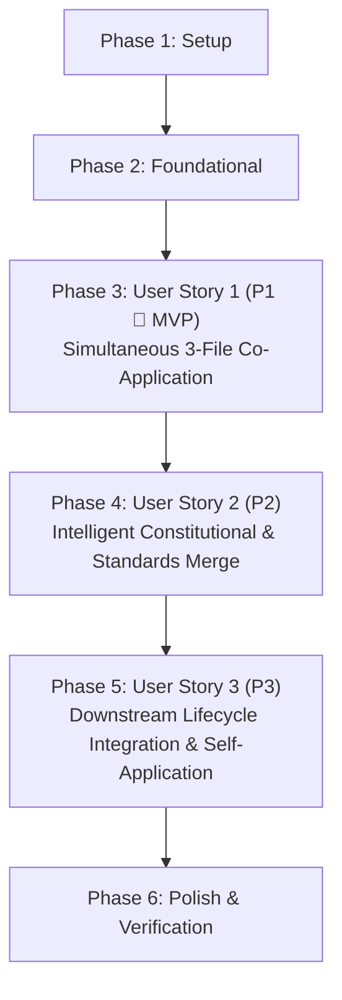

# Tasks: Co-Applied Governance & Constitutional Merge

**Input**: Design documents from `specs/002-co-applied-governance-merge/`
**Prerequisites**: [plan.md](file:///home/admin/projects/spec-kit-testing/specs/002-co-applied-governance-merge/plan.md), [spec.md](file:///home/admin/projects/spec-kit-testing/specs/002-co-applied-governance-merge/spec.md), [data-model.md](file:///home/admin/projects/spec-kit-testing/specs/002-co-applied-governance-merge/data-model.md), [contracts/co-applied-governance-merge-contract.md](file:///home/admin/projects/spec-kit-testing/specs/002-co-applied-governance-merge/contracts/co-applied-governance-merge-contract.md), [contracts/downstream-skill-governance-contract.md](file:///home/admin/projects/spec-kit-testing/specs/002-co-applied-governance-merge/contracts/downstream-skill-governance-contract.md), [quickstart.md](file:///home/admin/projects/spec-kit-testing/specs/002-co-applied-governance-merge/quickstart.md), [research.md](file:///home/admin/projects/spec-kit-testing/specs/002-co-applied-governance-merge/research.md)

**Verification**: Static analysis, syntax validation (`bash -n`), and markdown link verification per Constitution v2.0.0 Principle III (*Static Verification & No Automated Tests*) and `coding-standards.md`. Zero automated test suites generated.

**Organization**: Tasks are grouped by user story to enable independent implementation and testing of each story.

## Format: `[ID] [P?] [Story?] Description`

- **[P]**: Can run in parallel (different files, no dependencies)
- **[Story]**: Which user story this task belongs to (e.g., US1, US2, US3)
- Include exact file paths in descriptions

---

## Phase 1: Setup (Shared Infrastructure)

**Purpose**: Verify governance template source files, resolution tools, and project directory scaffolding before implementation.

- [X] T001 Verify presence and integrity of governance templates in `.specify/templates/constitution-template.md`, `.specify/templates/coding-standards-template.md`, `.specify/templates/logging-standards-template.md`, and resolver `.specify/scripts/bash/resolve-template.sh`
- [X] T002 [P] Verify storage directory readiness for the co-applied governance suite at `.specify/memory/`

---

## Phase 2: Foundational (Blocking Prerequisites)

**Purpose**: Core governance interface and downstream contract verification that MUST be established before user story workflows begin.

**⚠️ CRITICAL**: No user story implementation work can begin until this phase is complete.

- [X] T003 [P] Verify Scope Guard, 4-tier template resolution hierarchy, and pre-write validation invariants in `specs/002-co-applied-governance-merge/contracts/co-applied-governance-merge-contract.md`
- [X] T004 [P] Verify shared 3-file governance loading rules and graceful legacy fallback contracts in `specs/002-co-applied-governance-merge/contracts/downstream-skill-governance-contract.md`

**Checkpoint**: Foundation ready — user story implementation can now begin in priority order.

---

## Phase 3: User Story 1 - Simultaneous Co-Application of All Three Governance Documents (Priority: P1) 🎯 MVP

**Goal**: Upgrade `.agents/skills/speckit-constitution/SKILL.md` so that creating or updating the project constitution resolves all three templates (`constitution-template`, `coding-standards-template`, `logging-standards-template`), synchronizes `[PROJECT_NAME]` across all three documents, and writes `.specify/memory/constitution.md`, `.specify/memory/coding-standards.md`, and `.specify/memory/logging-standards.md` in a single execution.

**Independent Verification**: Verify that all three files exist in `.specify/memory/`, have non-zero size, share an identical `[PROJECT_NAME]` H1 header, and leave templates under `.specify/templates/` untouched.

### Implementation for User Story 1

- [X] T006 [US1] Update Scope Guard in `.agents/skills/speckit-constitution/SKILL.md` to authorize reading/writing `.specify/memory/constitution.md`, `.specify/memory/coding-standards.md`, and `.specify/memory/logging-standards.md` while strictly prohibiting modifying `.specify/templates/`, `.specify/presets/`, or application code
- [X] T007 [US1] Implement dual-mode template resolution in `.agents/skills/speckit-constitution/SKILL.md` to resolve `constitution-template`, `coding-standards-template`, and `logging-standards-template` via `.specify/scripts/bash/resolve-template.sh <name> --json` with platform-agnostic 4-tier fallback (`.specify/templates/overrides/` -> `.specify/presets/*/templates/` -> `.specify/extensions/*/templates/` -> `.specify/templates/`)
- [X] T008 [US1] Implement placeholder discovery and synchronized substitution logic in `.agents/skills/speckit-constitution/SKILL.md` for all 25 `[ALL_CAPS_IDENTIFIER]` slots (8 in `constitution-template.md`, 11 in `coding-standards-template.md`, 6 in `logging-standards-template.md`), enforcing verbatim constraint: "`project_name` (`[PROJECT_NAME]`): Non-empty string; MUST be identical across the H1 headers (`# <project_name> Constitution`, `# <project_name> Coding Standards`, `# <project_name> Logging Standards`) and inline project references in all three files"
- [X] T009 [US1] Implement atomic 3-file persistence and completion reporting in `.agents/skills/speckit-constitution/SKILL.md` to write `.specify/memory/constitution.md`, `.specify/memory/coding-standards.md`, and `.specify/memory/logging-standards.md` and report deferred non-governance intents under Next Actions

**Checkpoint**: At this point, User Story 1 is fully functional as the MVP increment. `/speckit-constitution` can resolve, populate, and write all 3 governance files simultaneously.

---

## Phase 4: User Story 2 - Intelligent Constitutional & Standards Merge with Optional Module Resolution (Priority: P2)

**Goal**: Implement intelligent merge logic in `.agents/skills/speckit-constitution/SKILL.md` to evaluate Optional Enhancement Modules (`MODULE-A`–`MODULE-D`, `MODULE-D-AOT-TRIM`, and optional `TRACE` logging), execute clean structural transformations stripping all template comment markers, enforce the 5-field Recorded Deviations conflict gate, and generate the structured `Sync Impact Report`.

**Independent Verification**: Verify zero `[ALL_CAPS_IDENTIFIER]` tokens remain, zero `OPTIONAL-MODULE`, `OPTIONAL-SUBCLAUSE`, or `DEFAULT-CLAUSE` HTML comments remain in `constitution.md`, Principle III enforces mutual exclusivity between Plan Justification & Skip Allowlist and 100% Branch Coverage Gate, and prior valid `Recorded Deviations` are preserved.

### Implementation for User Story 2

- [X] T011 [US2] Implement Optional Enhancement Module activation rules in `.agents/skills/speckit-constitution/SKILL.md` following precedence: `(1) Explicit User Input -> (2) Existing Ratified .specify/memory/constitution.md State -> (3) Repository Context Inference (defaulting unrequested/unevidenced modules to OMITTED)`, handling enum `{"ENABLED", "OMITTED"}` for `module_a`, `module_b`, `module_c`, `module_d`, `module_d_aot_trim`, and `logging_trace`
- [X] T012 [US2] Implement structural transformation rules in `.agents/skills/speckit-constitution/SKILL.md` for `constitution.md`:
  - Retain enabled `ADD` modules (`MODULE-A`, `MODULE-C`, `MODULE-D`) and strip `<!-- OPTIONAL-MODULE: MODULE-X ... -->` comments
  - Unwrap `[Optional: ...]` to normative prose for `MODULE-D-AOT-TRIM` when enabled, or strip if omitted or parent `MODULE-D` omitted ("If `module_d == OMITTED`, `module_d_aot_trim` MUST be `OMITTED`. If `module_d == ENABLED` and `module_d_aot_trim == ENABLED`, the surrounding `[Optional: ...]` brackets MUST be unwrapped so the sentence reads as normative prose (`Shared libraries consumed by constrained environments SHOULD be AOT/trim-safe...`)")
  - Enforce mutual exclusivity for `MODULE-B` (REPLACE `PLAN-JUSTIFICATION-AND-SKIP-ALLOWLIST`): "When `module_b == ENABLED`, Principle III MUST contain `- **100% Branch Coverage Gate**:` and MUST NOT contain `- **Plan Justification & Skip Allowlist**:`. When `module_b == OMITTED`, Principle III MUST contain `- **Plan Justification & Skip Allowlist**:` and MUST NOT contain `- **100% Branch Coverage Gate**:`"
  - Strip all `OPTIONAL-MODULE`, `OPTIONAL-SUBCLAUSE`, and `DEFAULT-CLAUSE` HTML comment lines
- [X] T013 [US2] Implement Constitutional Conflict Resolution Gate and 5-field Recorded Deviation persistence in `.agents/skills/speckit-constitution/SKILL.md`:
  - Base Core Principles I–VII are non-negotiable and MUST NOT be silently deleted, weakened, or contradicted
  - Mandatory fields for Recorded Deviations: `(1) Principle violated`, `(2) Ratifying human authority`, `(3) Rationale`, `(4) Compensating control`, and `(5) Known gap and documentation link`
  - Preserve original `RATIFICATION_DATE` (regex: `^[0-9]{4}-[0-9]{2}-[0-9]{2}$`) and increment `CONSTITUTION_VERSION` (regex: `^[0-9]+\.[0-9]+\.[0-9]+$`) per semantic versioning rules
- [X] T014 [US2] Implement updated `Sync Impact Report` generator in `.agents/skills/speckit-constitution/SKILL.md` formatting the top HTML comment in `.specify/memory/constitution.md` with: `Version Change`, `Modified Principles`, `Modified Sections`, `Optional Modules`, `Companion Standards`, `Rationale`, and `Deferred TODOs` ("Must only record the *latest* amendment (do not accumulate historical amendment logs inside the file)")
- [X] T015 [US2] Implement pre-write validation gate in `.agents/skills/speckit-constitution/SKILL.md` enforcing: regex search `\[[A-Z0-9_]+\]` returns 0 matches across all 3 files, regex search `<!-- /?(OPTIONAL-MODULE|OPTIONAL-SUBCLAUSE|DEFAULT-CLAUSE)` in `constitution.md` returns 0 matches, and dates match `YYYY-MM-DD`

**Checkpoint**: At this point, User Stories 1 and 2 are functional. The merge workflow intelligently incorporates modules and project context while strictly preserving constitutional integrity.

---

## Phase 5: User Story 3 - Downstream Spec Kit Lifecycle Integration & Repository Self-Application (Priority: P3)

**Goal**: Update all 5 downstream governance-aware skills (`speckit-plan`, `speckit-tasks`, `speckit-analyze`, `speckit-implement`, `speckit-converge`) to load and enforce `coding-standards.md` and `logging-standards.md` alongside `constitution.md`, and self-apply the co-applied suite to `spec-kit-testing`.

**Independent Verification**: Verify that all 5 downstream skill definitions load all 3 governance files, and verify that `.specify/memory/` in `spec-kit-testing` contains all 3 valid, populated governance documents.

### Implementation for User Story 3

- [X] T017 [P] [US3] Update `.agents/skills/speckit-plan/SKILL.md` to load `.specify/memory/constitution.md`, `.specify/memory/coding-standards.md`, and `.specify/memory/logging-standards.md` in Step 2, and evaluate Technical Context and Constitution Check compliance against the 3-file suite in Step 3 per downstream skill contract
- [X] T018 [P] [US3] Update `.agents/skills/speckit-tasks/SKILL.md` to load `.specify/memory/constitution.md`, `.specify/memory/coding-standards.md`, and `.specify/memory/logging-standards.md` under Step 2 (IF EXISTS), and ensure generated tasks honor compile-time boundaries, error result types, testing conventions, and structured logging rules in Step 3 per downstream skill contract
- [X] T019 [P] [US3] Update `.agents/skills/speckit-analyze/SKILL.md` to declare 3-document governance authority under Operating Constraints, load `.specify/memory/coding-standards.md` and `.specify/memory/logging-standards.md` in Step 2, build semantic rule sets in Step 3, and flag conflicts with `constitution.md` MUST principles or companion standards MUST rules as CRITICAL in Step 4.D per downstream skill contract
- [X] T020 [P] [US3] Update `.agents/skills/speckit-implement/SKILL.md` to load `.specify/memory/constitution.md`, `.specify/memory/coding-standards.md`, and `.specify/memory/logging-standards.md` in Step 3 (IF EXISTS), and enforce coding, error-handling, testing, and logging conventions during task execution and completion validation in Steps 6-9 per downstream skill contract
- [X] T021 [P] [US3] Update `.agents/skills/speckit-converge/SKILL.md` to declare 3-document governance authority under Operating Constraints, initialize paths in Step 1, load non-template governance rules in Step 2, and include buildable obligations from all 3 files in the intent inventory in Step 3 per downstream skill contract
- [X] T022 [US3] Execute repository self-application on `spec-kit-testing`: materialize `.specify/memory/coding-standards.md` and `.specify/memory/logging-standards.md` populated from repository context (CommonMark/Markdown + Bash 4.0+ stack, non-zero POSIX error exits, zero external dependencies), and update `.specify/memory/constitution.md` with the new `Sync Impact Report` header (recording `1.0.0` version, `2026-11-04` ratification date, optional modules omitted, and companion standards created)

**Checkpoint**: All three user stories are complete. The entire Spec Kit governance lifecycle is synchronized and actively enforced across this repository and downstream commands.

---

## Phase 6: Polish & Cross-Cutting Concerns

**Purpose**: Final end-to-end acceptance verification and documentation consistency check.

- [X] T024 [P] Verify documentation links in `specs/002-co-applied-governance-merge/` artifacts and confirm zero leftover temporary or scratch files

---

## Dependencies & Execution Order

### Phase Dependencies

- **Setup (Phase 1)**: No dependencies — executes immediately.
- **Foundational (Phase 2)**: Depends on Phase 1 completion — BLOCKS all user stories.
- **User Story 1 (Phase 3)**: Depends on Phase 2 completion. Can proceed independently as MVP.
- **User Story 2 (Phase 4)**: Depends on Phase 3 completion (extends `speckit-constitution` with module resolution and merge gates).
- **User Story 3 (Phase 5)**: Downstream skill updates (T017–T021) depend on Phase 2; repository self-application (T022) depends on Phase 4 completion so the full merge rules and `Sync Impact Report` schema are active.
- **Polish (Phase 6)**: Depends on completion of all user stories (Phases 3, 4, 5).

### User Story Completion Order



### Within Each User Story

- Skill outline and Scope Guard updates precede detailed resolution and merge routines.
- Pre-write validation gates precede file persistence.
- Story complete and validated before advancing to subsequent phases.

### Parallel Opportunities

- In Phase 1: T002 can run in parallel with T001.
- In Phase 2: T003 and T004 can run in parallel.
- In Phase 5: Downstream skill updates T017, T018, T019, T020, T021 can all run in parallel because they modify separate skill files:
  - `speckit-plan/SKILL.md` (T017)
  - `speckit-tasks/SKILL.md` (T018)
  - `speckit-analyze/SKILL.md` (T019)
  - `speckit-implement/SKILL.md` (T020)
  - `speckit-converge/SKILL.md` (T021)

---

## Parallel Execution Examples

### Parallel Example: User Story 3 (Downstream Skills)
```bash
# Update all 5 downstream skills simultaneously:
Task: "T017 [P] [US3] Update .agents/skills/speckit-plan/SKILL.md"
Task: "T018 [P] [US3] Update .agents/skills/speckit-tasks/SKILL.md"
Task: "T019 [P] [US3] Update .agents/skills/speckit-analyze/SKILL.md"
Task: "T020 [P] [US3] Update .agents/skills/speckit-implement/SKILL.md"
Task: "T021 [P] [US3] Update .agents/skills/speckit-converge/SKILL.md"
```

---

## Implementation Strategy

### MVP First (User Story 1 Only)
1. Complete Phase 1: Setup (T001, T002).
2. Complete Phase 2: Foundational (T003, T004).
3. Complete Phase 3: User Story 1 (T006–T009).
4. **STOP and VALIDATE**: Verify `/speckit-constitution` resolves all 3 templates and writes all 3 documents.

### Incremental Delivery
1. Foundation + US1 delivers MVP (simultaneous 3-file resolution and creation).
2. Add US2 (T011–T015): Adds intelligent merge, module selection (`MODULE-A`–`MODULE-D`), Recorded Deviations gate, and clean comment stripping.
3. Add US3 (T017–T022): Propagates 3-document governance across downstream skills (`plan`, `tasks`, `analyze`, `implement`, `converge`) and self-applies suite to `spec-kit-testing`.
4. Polish (T024): Verify documentation link integrity and workspace hygiene.
