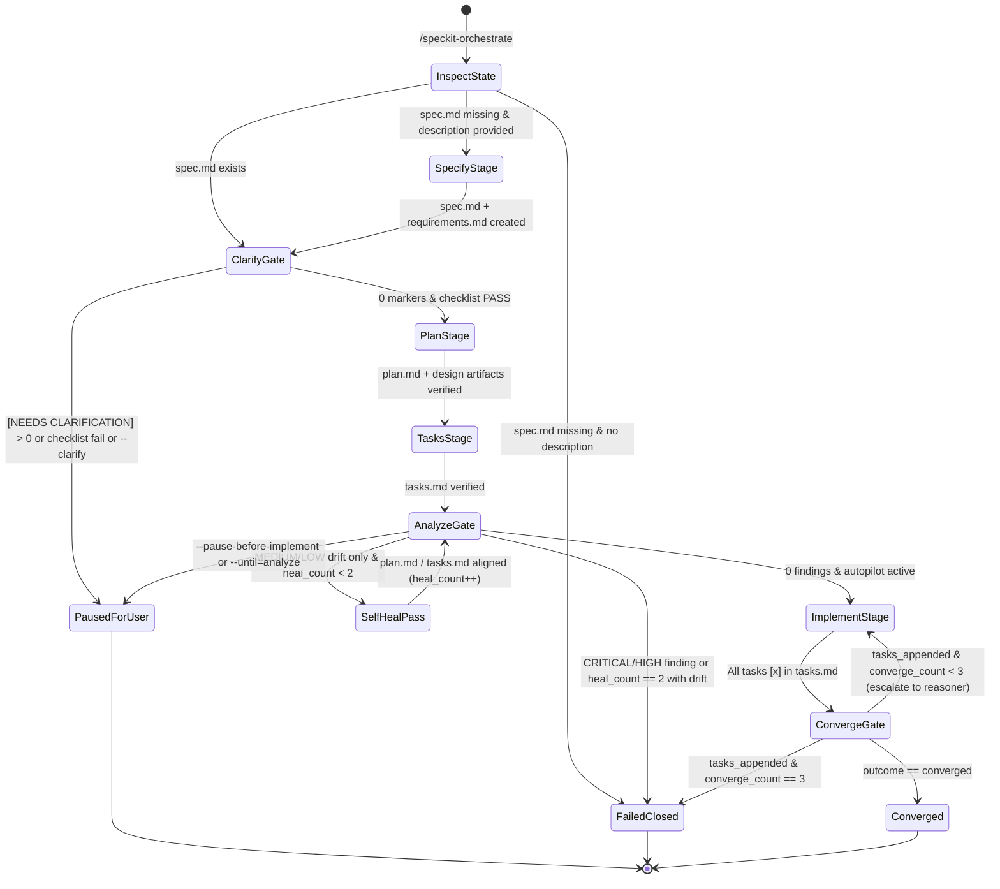

# Phase 1 Data Model: Subagent-Driven Spec Kit Orchestrator

**Feature**: `003-subagent-orchestrator`  
**Date**: 2026-11-05  
**Spec**: [spec.md](./spec.md) | **Research**: [research.md](./research.md)

## Overview

Because Spec Kit is a declarative Markdown- and Bash-based specification workflow system with zero external database dependencies, all domain entities are persisted as structured Markdown documents (with YAML frontmatter), YAML configuration files, or JSON state files on disk, or held as bounded in-memory state records within the `speckit-orchestrate` coordinator session.

---

## Entity 1: `AgentProfile` (`.agents/agents/speckit-*.md`)

Represents a reusable subagent persona, capability tier, provider-adaptive model mapping, and tool permission profile loaded by `speckit-orchestrate` before spawning a stage subagent.

### Storage & Resolution Path
- **Canonical Tracked Files**:
  - `.agents/agents/speckit-reasoner.md`
  - `.agents/agents/speckit-executor.md`
- **Optional Local / Per-Stage Override Files**:
  - `.agents/agents/speckit-<stage>.local.md` (gitignored)
  - `.agents/agents/speckit-<stage>.md` (tracked)
  - `.agents/agents/speckit-<role>.local.md` (gitignored)

### Schema (YAML Frontmatter + Markdown Body)

| Field | Type | Required | Constraints / Validation Rules |
| :--- | :--- | :--- | :--- |
| `name` | `string` | Yes | Kebab-case identifier matching filename stem (`speckit-reasoner`, `speckit-executor`, or `speckit-<stage>`). |
| `description` | `string` | Yes | Non-empty summary of the subagent's role and assigned pipeline stages. |
| `role_tier` | `enum` | Yes | Must be `"reasoning"` or `"execution"`. |
| `default_stages` | `list<string>` | Yes | Non-empty subset of `["specify", "clarify", "plan", "tasks", "analyze", "implement", "converge", "self-heal", "converge-retry"]`. |
| `model_policy.gemini_antigravity` | `string` | Yes | `"inherit"` (Argon/Pro when session ceiling permits) for `reasoning`; `"flash"` for `execution`. |
| `model_policy.claude` | `string` | Yes | `"opus"` (or `"inherit"`) for `reasoning`; `"sonnet"` for `execution`. |
| `model_policy.respect_session_ceiling` | `boolean` | Yes | Defaults to `true`. When `true`, resolved model tier cannot exceed the active session model tier. |
| `model_policy.override_ceiling` | `boolean` | No | Defaults to `false`. Only set to `true` in `.local.md` or explicit user override when escalating above a low-tier session model is desired. |
| `tools.enable_write_tools` | `boolean` | Yes | `true` for artifact-writing stages (`specify`, `clarify`, `plan`, `tasks`, `implement`, `converge`, `self-heal`); `false` when invoked strictly for read-only `analyze`. |
| `tools.enable_subagent_tools` | `boolean` | Yes | `false` by default (only `true` for `implement` when `[P]` parallel worker subagents are needed). |
| `tools.enable_mcp_tools` | `boolean` | Yes | `false` by default unless required by project context. |
| `body` (Markdown) | `string` | Yes | System prompt defining constitutional obedience (Principles I–VII, specifically Principle III no-test rule), single-writer boundary rules, hook anti-recursion rules, and required completion report schema. |

---

## Entity 2: `OrchestratorInvocationContext`

Represents the resolved runtime parameters and feature state at the start of `/speckit-orchestrate`.

### Fields

| Field | Type | Required | Constraints / Validation Rules |
| :--- | :--- | :--- | :--- |
| `raw_arguments` | `string` | No | Raw `$ARGUMENTS` string passed to `/speckit-orchestrate`. |
| `feature_description` | `string` | Conditional | Required if `.specify/feature.json` / `SPECIFY_FEATURE_DIRECTORY/spec.md` does not exist. |
| `feature_directory` | `string` (path) | Yes | Resolved via `SPECIFY_FEATURE_DIRECTORY` or `.specify/feature.json` (`feature_directory`). Must resolve to an existing directory under repo root (or be created by Stage 1 `specify`). |
| `from_stage` | `enum` | No | Optional stage name (`specify`, `clarify`, `plan`, `tasks`, `analyze`, `implement`, `converge`) forcing regeneration from that stage onward. |
| `until_stage` | `enum` | No | Optional stopping stage (`clarify`, `plan`, `tasks`, `analyze`, `implement`, `converge`). Note: `--pause-before-implement` is an alias for `--until=analyze`. |
| `force_clarify` | `boolean` | Yes | Defaults to `false`; `true` when `--clarify` is passed. |
| `session_model_tier` | `enum` | Yes | Detected active session model tier: `"high_reasoning"` (e.g., Gemini Argon/Pro, Claude Opus) or `"standard_execution"` (e.g., Gemini Flash/Flash Lite, Claude Sonnet/Haiku). |
| `override_ceiling` | `boolean` | Yes | Defaults to `false`; `true` if `--override-ceiling` passed in `$ARGUMENTS` or set in resolved `.agents/agents/*.local.md`. |
| `governance_files` | `list<string>` | Yes | Paths to `.specify/memory/constitution.md` (required), `.specify/memory/coding-standards.md`, and `.specify/memory/logging-standards.md`. |

---

## Entity 3: `PipelineStageDescriptor`

Defines the static execution contract for each of the 7 ordered stages in the orchestrator state machine.

| Stage Order | Stage ID | Default Role Agent | Target Skill Path | Required Input Artifacts | Expected Output Artifacts | Gate / Loop Bound |
| :--- | :--- | :--- | :--- | :--- | :--- | :--- |
| `1` | `specify` | `speckit-executor` | `.agents/skills/speckit-specify/SKILL.md` | `feature_description` in `$ARGUMENTS` | `.specify/feature.json`, `spec.md`, `checklists/requirements.md` | Single pass (skip if `spec.md` exists and `--from=specify` not set) |
| `2` | `clarify` | `speckit-reasoner` | `.agents/skills/speckit-clarify/SKILL.md` | `spec.md`, `checklists/requirements.md` | Updated `spec.md` & `checklists/requirements.md` (or 0-ambiguity pass) | **Clarify Gate**: Pause for user if `[NEEDS CLARIFICATION]` > 0, checklist fails, or `--clarify` set |
| `3` | `plan` | `speckit-reasoner` | `.agents/skills/speckit-plan/SKILL.md` | `spec.md`, `.specify/memory/*` | `plan.md`, `research.md`, `data-model.md`, `quickstart.md`, `contracts/*` (if applicable) | Single pass (skip if `plan.md` exists and non-empty, unless `--from=plan` or earlier) |
| `4` | `tasks` | `speckit-executor` | `.agents/skills/speckit-tasks/SKILL.md` | `spec.md`, `plan.md`, optional `data-model.md`/`contracts/*`/`research.md` | `tasks.md` | Single pass (skip if `tasks.md` exists and non-empty, unless `--from=tasks` or earlier) |
| `5` | `analyze` | `speckit-reasoner` | `.agents/skills/speckit-analyze/SKILL.md` | `spec.md`, `plan.md`, `tasks.md`, `.specify/memory/*` | In-session Analysis Report (and optional self-heal edits to `plan.md`/`tasks.md`) | **Analyze & Self-Heal Gate**: Max **2** self-heal iterations on `MEDIUM`/`LOW` drift; fail closed on `CRITICAL`/`HIGH` |
| `6` | `implement` | `speckit-executor` (initial) / `speckit-reasoner` (retry) | `.agents/skills/speckit-implement/SKILL.md` | `spec.md`, `plan.md`, `tasks.md`, `.specify/memory/*` | Implemented repository files + `[x]` markers in `tasks.md` | Bounded by **Convergence Gate** loop (max **3** passes) |
| `7` | `converge` | `speckit-reasoner` | `.agents/skills/speckit-converge/SKILL.md` | `spec.md`, `plan.md`, `tasks.md`, `.specify/memory/*`, repo files | `converged` status OR appended `## Phase N: Convergence` in `tasks.md` | **Convergence Gate**: Max **3** `implement` ↔ `converge` iterations |

---

## Entity 4: `StageGateResult` & State Machine Transitions

Captures the deterministic evaluation outcome after a gate or stage execution.

### Allowed Gate Outcomes (`status`)
- `SKIPPED_EXISTING`: Valid output artifact already exists on disk and regeneration was not requested.
- `PASSED`: Stage and its associated quality gate succeeded with 0 blocking issues.
- `SELF_HEALED`: `Analyze & Self-Heal Gate` detected `MEDIUM`/`LOW` drift, remediated `plan.md`/`tasks.md` within ≤ 2 passes, and re-verified clean analysis.
- `PAUSED_FOR_USER`: Pipeline halted cleanly at a human checkpoint (`Clarify Gate` with open questions, or user-requested `--until=<stage>` / `--pause-before-implement`).
- `FAILED_CLOSED`: Pipeline halted immediately due to a subagent error, missing required output artifact, `CRITICAL`/`HIGH` analysis finding, or exceeding a bounded retry ceiling (2 self-heal passes or 3 convergence passes).

### State Transition Diagram

---

## Entity 5: `ExtensionHookRegistry` (`.specify/extensions.yml`)

Defines the YAML hook configuration at the repository root that wires `/speckit-specify` completion to `/speckit-orchestrate`.

### Schema & Validation Rules

| Key Path | Type | Required | Value / Constraint |
| :--- | :--- | :--- | :--- |
| `hooks.after_specify` | `list<HookEntry>` | Yes | List of post-specification hook definitions read by `speckit-specify/SKILL.md`. |
| `hooks.after_specify[].extension` | `string` | Yes | `"speckit-orchestrator"` |
| `hooks.after_specify[].command` | `string` | Yes | `"speckit.orchestrate"` (mapped by Spec Kit hook runner to `/speckit-orchestrate`). |
| `hooks.after_specify[].description` | `string` | Yes | Human-readable explanation of the subagent orchestrator pipeline. |
| `hooks.after_specify[].prompt` | `string` | Yes | Actionable prompt shown when `optional: true`. |
| `hooks.after_specify[].enabled` | `boolean` | Yes | `true` |
| `hooks.after_specify[].optional` | `boolean` | Yes | `true` by default (can be toggled to `false` for zero-click automatic invocation after `/speckit-specify`). |
