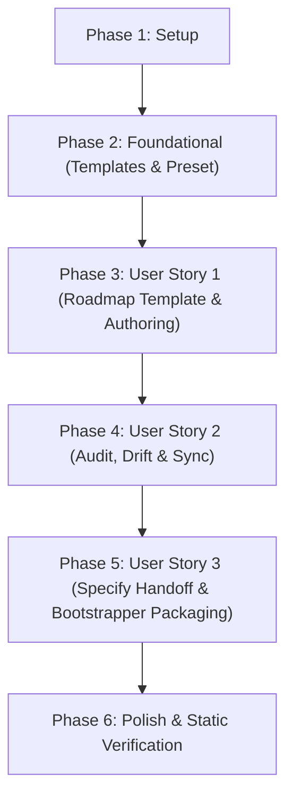

# Tasks: Roadmap Management (`speckit-roadmap`)

<!--
Template Resolution Hierarchy & FeatureContext Specification:
This artifact was generated by speckit-tasks using the native 4-tier template resolution hierarchy:
- Tier 1 (Overrides): .specify/templates/overrides/tasks-template.md
- Tier 2 (Presets): .specify/presets/base-governance/templates/tasks-template.md
- Tier 3 (Extensions): .specify/extensions/<ext-id>/templates/tasks-template.md
- Tier 4 (Core Fallback): .specify/templates/tasks-template.md

Principle III Static Verification Notice:
In strict compliance with Constitutional Principle III (No Automated Tests), this task breakdown contains ZERO unit tests, integration test harnesses, mock frameworks, or test tasks. All quality assurance and verification rely exclusively on static syntax verification (bash -n), structural schema linting, declarative quality gates, and SHA-256 manifest integrity checks.
-->

**Input**: Design documents from `specs/005-roadmap-management/` (`spec.md`, `plan.md`, `research.md`, `data-model.md`, `contracts/`, `quickstart.md`)  
**Prerequisites**: `plan.md` (completed), `spec.md` (completed), `data-model.md` (completed), `contracts/` (completed)  
**Tests**: OPTIONAL / EXCLUDED per ratified Constitutional Principle III (*Static Verification & No Automated Tests*)  
**Organization**: Tasks are grouped by user story (US1, US2, US3) to enable independent implementation and static verification.

---

## Format: `[ID] [P?] [Story] Description`

- **[P]**: Can run in parallel (different files, no dependencies on incomplete tasks)
- **[Story]**: Which user story this task belongs to (`[US1]`, `[US2]`, `[US3]`)
- Every task includes an explicit, unambiguous file path and quotes exact constraints from `data-model.md` and `contracts/`

---

## Phase 1: Setup (Shared Infrastructure)

**Purpose**: Worktree layout initialization and workspace configuration

- [x] T001 Create skill directory structure for the 12th managed Spec Kit skill in `.agents/skills/speckit-roadmap/`
- [x] T002 [P] Verify git worktree exclusion entry `.worktrees/` in `.git/info/exclude` to guarantee worktree paths never appear as untracked files

---

## Phase 2: Foundational (Blocking Prerequisites)

**Purpose**: Core templates and preset configuration that underpin all user stories

**⚠️ CRITICAL**: Must complete before any user story implementation can begin

- [x] T003 [P] Create core fallback template in `.specify/templates/roadmap-template.md` defining the 7 canonical columns in `## Overview of Initiatives` (`Phase`, `Initiative`, `Status`, `Prerequisites`, `Spec`, `Goal`, `Key Deliverables`) and detailed sections `## Phase N: [Initiative Title]` containing `### Metadata` (`Status`, `Prerequisites`, `Spec Directory`), `### Problem Statement`, `### Architectural Fit in Spec Kit` (accepting `### Architectural Fit & Scope` as a valid secondary heading alias), `### Key Deliverables`, and `### Key Design Decisions to Resolve During Spec`, enforcing closed status enum `{PLANNED, IN_PROGRESS, COMPLETED, DEFERRED}` and prerequisite constraints
- [x] T004 [P] Create preset roadmap template in `.specify/presets/base-governance/templates/roadmap-template.md` synchronized bit-for-bit with `.specify/templates/roadmap-template.md`
- [x] T005 Register `roadmap-template` in `.specify/presets/base-governance/preset.yml` under `provides.templates` with `type: "template"`, `name: "roadmap-template"`, `file: "templates/roadmap-template.md"`, and `strategy: "replace"`

**Checkpoint**: Foundational templates and preset registry established. User stories can now proceed.

---

## Phase 3: User Story 1 - Standardized Roadmap Template & Guided Roadmap Authoring via `/speckit-roadmap` (Priority: P1) 🎯 MVP

**Goal**: Provide a canonical `roadmap-template.md` resolved via Spec Kit's 4-tier template hierarchy and implement authoring, scaffolding, and phase mutation modes in `/speckit-roadmap` to generate and update conforming `ROADMAP.md` files.

**Independent Test**: Verify template resolution across the 4 tiers, execute `/speckit-roadmap` to scaffold/migrate `ROADMAP.md`, and verify that the Overview table contains all 7 columns and matches 1-to-1 sequentially with `## Phase N:` sections and `### Metadata` blocks.

### Implementation for User Story 1

- [x] T006 [P] [US1] Implement template resolution hierarchy and Pre-Execution checks in `.agents/skills/speckit-roadmap/SKILL.md` resolving `roadmap-template` across Tier 1 (`.specify/templates/overrides/roadmap-template.md`), Tier 2 (`.specify/presets/base-governance/templates/roadmap-template.md`), Tier 3 (`.specify/extensions/<ext-id>/templates/roadmap-template.md`), and Tier 4 (`.specify/templates/roadmap-template.md`), failing closed with a `CRITICAL` diagnostic if missing across all tiers per Constitutional Principle II
- [x] T007 [P] [US1] Implement Mode 1 (Scaffold / Interactive Authoring) in `.agents/skills/speckit-roadmap/SKILL.md` enforcing `RoadmapDocument` entity invariants: document H1 `title` (string, required: `# [PROJECT NAME] Roadmap`), `last_updated` (string, ISO-8601 date `YYYY-MM-DD`, required), `overview_table` (array of `RoadmapOverviewRow`, required), and `phases` (array of `RoadmapPhase`, required) where `overview_table.length == phases.length` and `phases.length >= 1`, 1-to-1 sequential matching, and preserving all existing prose during migration
- [x] T008 [US1] Implement Mode 2 (Phase Mutation: `--add`, `--update <phase-id>`, `--defer <phase-id>`) in `.agents/skills/speckit-roadmap/SKILL.md` enforcing `phase_id` matching `^Phase [1-9][0-9]*$` (unique across `ROADMAP.md`), `declared_status` enum `{PLANNED, IN_PROGRESS, COMPLETED, DEFERRED}`, and prerequisite constraints where every entry in `prerequisites` (when not `["None"]`) references a valid existing `phase_id` with `phase_number < current.phase_number` (no self-references, dangling references, or cyclic dependencies)
- [x] T009 [US1] Upgrade repository root `ROADMAP.md` to conform to the canonical `roadmap-template.md` schema with all 7 columns in `## Overview of Initiatives` (`Phase`, `Initiative`, `Status`, `Prerequisites`, `Spec`, `Goal`, `Key Deliverables`) and 6 sequential `## Phase N:` detailed sections with `### Metadata`, `### Problem Statement`, `### Architectural Fit in Spec Kit`, `### Key Deliverables`, and `### Key Design Decisions to Resolve During Spec`

**Checkpoint**: At this point, User Story 1 is fully functional. `ROADMAP.md` adheres to the canonical schema and `/speckit-roadmap` can author and mutate phases.

---

## Phase 4: User Story 2 - Automated Roadmap Status Audit, Drift Detection & Reconciliation (Priority: P2)

**Goal**: Provide automated status auditing, static schema linting, drift detection, and deterministic status reconciliation between `ROADMAP.md` and repository artifacts.

**Independent Test**: Invoke `/speckit-roadmap --check` and `--status` to audit Phases 1–6 against `specs/001-*` through `specs/005-*` and git worktree history, confirming static lint passes and status drift is detected and reconcilable via `--sync`.

### Implementation for User Story 2

- [x] T010 [P] [US2] Implement Mode 3 static structural linting (`--check`) in `.agents/skills/speckit-roadmap/SKILL.md` enforcing gates `RM-LINT-001` (`ROADMAP.md` exists and non-empty), `RM-LINT-002` (all 7 canonical columns present in Overview table), `RM-LINT-003` (1-to-1 sequential correspondence between `**Phase N**` rows and `## Phase N:` sections with no duplicate phase numbers), `RM-LINT-004` (every `Status` token is a valid member of `{PLANNED, IN_PROGRESS, COMPLETED, DEFERRED}` matching between Overview and `### Metadata`), `RM-LINT-005` (acyclic earlier prerequisites `M < N`), and `RM-LINT-006` (all 5 required subsections present in each `## Phase N` section: `### Metadata`, `### Problem Statement`, canonical `### Architectural Fit in Spec Kit` or valid secondary heading alias `### Architectural Fit & Scope`, `### Key Deliverables`, and `### Key Design Decisions to Resolve During Spec`)
- [x] T011 [US2] Implement deterministic evidence inference engine (`InferredEvidenceStatus`) in `.agents/skills/speckit-roadmap/SKILL.md` evaluating `COMPLETED` (matching `specs/NNN-*` contains `spec.md`, `plan.md`, and `tasks.md` where total tasks > 0 and unchecked tasks `- [ ]` == 0, or git commit records phase completion), `IN_PROGRESS` (matching `specs/NNN-*` exists in checkout or active git worktree from `git worktree list` with `spec.md` present and tasks open), `PLANNED` (no spec directory, active worktree, or commit), and `DEFERRED` (preserved human override from `ROADMAP.md`)
- [x] T012 [US2] Implement Mode 3 status audit and drift reporting (`--status`) in `.agents/skills/speckit-roadmap/SKILL.md` classifying reconciliation state as `SYNCED` (`declared_status == inferred_evidence_status` and `declared_spec_dir == resolved_spec_dir`), `STATUS_DRIFT` (mismatch between declared and inferred state), `AMBIGUOUS_MATCH` (multiple candidate specs matching without explicit link), or `STRUCTURAL_ERROR`, outputting the structured report table and diagnostics per `.specify/memory/logging-standards.md`
- [x] T013 [US2] Implement Mode 4 status synchronization (`--sync`) in `.agents/skills/speckit-roadmap/SKILL.md` updating `Status` and `Spec` in `ROADMAP.md` Overview table and `### Metadata` to match `InferredEvidenceStatus` and `resolved_spec_dir` while preserving all problem statements, architectural notes, and deliverables
- [x] T014 [US2] Reconcile and synchronize status markers in `ROADMAP.md` to reflect verified repository state: Phases 1–4 `COMPLETED` (`specs/001-*` through `specs/004-*`), Phase 5 `IN_PROGRESS` (`specs/005-roadmap-management/`), and Phase 6 `PLANNED` (`—`)

**Checkpoint**: At this point, User Stories 1 AND 2 are complete. `ROADMAP.md` can be statically audited and automatically synchronized against repository evidence.

---

## Phase 5: User Story 3 - Seamless Handoff from Roadmap Phase to `/speckit-specify` & Worktree Isolation (Priority: P3)

**Goal**: Provide automated handoff from `ROADMAP.md` to `/speckit-specify` with prerequisite checking and git worktree isolation, plus update the bootstrapper suite and manifests to distribute the 12th skill and protect `ROADMAP.md` as user state.

**Independent Test**: Execute `/speckit-roadmap --next` to verify prerequisite evaluation and handoff context extraction, test worktree creation rules, verify bootstrapper seeder scripts preserve existing `ROADMAP.md`, and verify all manifest SHA-256 digests.

### Implementation for User Story 3

- [x] T015 [P] [US3] Implement Mode 5 (Specify Handoff: `--next` and `--specify <phase-id>`) in `.agents/skills/speckit-roadmap/SKILL.md` selecting the earliest `PLANNED` phase whose declared `Prerequisites` are all `COMPLETED`, enforcing fail-closed `WARN` boundary rejection if prerequisites are incomplete unless `--force` is supplied, updating the selected phase's status to `IN_PROGRESS` with `specs/<NNN>-<short-name>/` in `ROADMAP.md`, and invoking `/speckit-specify`
- [x] T016 [P] [US3] Update `.agents/skills/speckit-specify/SKILL.md` to parse roadmap references (`"next roadmap phase"`, `"Phase N"`, `--next`), extract structured phase context (`Problem Statement`, `Architectural Fit in Spec Kit`, `Key Deliverables`, `Key Design Decisions to Resolve During Spec`) to populate `spec.md`, and transition `Status` to `IN_PROGRESS` with `specs/<NNN>-<short-name>/` in `ROADMAP.md`
- [x] T017 [US3] Update `.agents/skills/speckit-specify/SKILL.md` to implement the git worktree isolation protocol: create `.worktrees/<NNN>-<short-name>` on branch `<NNN>-<short-name>`, ensure `.worktrees/` in primary `.git/info/exclude`, and configure isolated `.worktrees/<NNN>-<short-name>/.specify/feature.json` with `{"feature_directory": "specs/<NNN>-<short-name>"}`
- [x] T018 [P] [US3] Update `bootstrap-speckit.sh` to include `.specify/templates/roadmap-template.md` in the required source files verification array, enforce `< 150` lines ceiling, and document `ROADMAP.md` in the Protected User-State Boundary (`PRESERVE_USER_STATE`)
- [x] T019 [P] [US3] Update `bootstrap-speckit.ps1` to include `.specify/templates/roadmap-template.md` in the required source files verification array, enforce `< 150` lines ceiling, and document `ROADMAP.md` in the Protected User-State Boundary (`PRESERVE_USER_STATE`)
- [x] T020 [P] [US3] Update `.agents/skills/speckit-bootstrap/SKILL.md` to add `ROADMAP.md` to the **Protected User-State Rule** (`PRESERVE_USER_STATE`) alongside `.specify/memory/*.md`, `.specify/templates/overrides/**`, `.specify/feature.json`, and `specs/**`, and increment managed skill count from 11 to 12
- [x] T021 [US3] Update integration manifest `.specify/integrations/speckit.manifest.json` to register `.specify/templates/roadmap-template.md` with SHA-256 digest
- [x] T022 [US3] Update integration manifest `.specify/integrations/agy.manifest.json` to register `.agents/skills/speckit-roadmap/SKILL.md` and refresh digests for modified skills (`speckit-specify`, `speckit-bootstrap`)
- [x] T023 [US3] Update integration manifest `.specify/integrations/speckit-bootstrap.manifest.json` to synchronize SHA-256 digests and byte sizes for all managed toolkit assets (`roadmap-template.md`, `preset.yml`, `speckit-roadmap/SKILL.md`, `speckit-specify/SKILL.md`, `speckit-bootstrap/SKILL.md`, `speckit.manifest.json`, `agy.manifest.json`)

**Checkpoint**: All three user stories are implemented. The toolkit bundle, bootstrapper suite, and roadmap workflows are fully integrated.

---

## Phase 6: Polish & Cross-Cutting Concerns

**Purpose**: Static verification, formatting checks, and compliance validation across all deliverables

- [x] T024 [P] Verify zero script execution dependencies (`.specify/scripts/` absent and zero references to `.specify/scripts/bash/`) across all 12 skills in `.agents/skills/`
- [x] T025 [P] Run POSIX shell syntax verification `bash -n bootstrap-speckit.sh` and verify line counts for `bootstrap-speckit.sh` and `bootstrap-speckit.ps1` are strictly below the 150 LOC ceiling
- [x] T026 Execute static validation scenarios from `specs/005-roadmap-management/quickstart.md` (Scenario 1 template bit-for-bit diff and preset check; Scenario 2 structural grep checks on `ROADMAP.md`; Scenario 3 100% script-free audit; Scenario 4 bootstrapper temporary target test preserving `ROADMAP.md`)
- [x] T027 Verify telemetry and error handling across `.agents/skills/speckit-roadmap/SKILL.md` and `.agents/skills/speckit-specify/SKILL.md` conform to `.specify/memory/logging-standards.md` (`INFO` for milestones, `WARN` for recoverable boundary rejections and drift, `CRITICAL` for fatal template resolution failures)

---

## Dependencies & Execution Order

### Phase Dependencies

- **Setup (Phase 1)**: No dependencies - can start immediately.
- **Foundational (Phase 2)**: Depends on Setup (Phase 1) completion - BLOCKS all user stories.
- **User Story 1 (Phase 3)**: Depends on Foundational (Phase 2) completion.
- **User Story 2 (Phase 4)**: Depends on Foundational (Phase 2) and User Story 1 (Phase 3) completion (requires `roadmap-template.md` and upgraded `ROADMAP.md`).
- **User Story 3 (Phase 5)**: Depends on Foundational (Phase 2), User Story 1 (Phase 3), and User Story 2 (Phase 4) completion (requires `speckit-roadmap` modes to be defined before bootstrapper packaging).
- **Polish (Phase 6)**: Depends on all user stories (Phases 3–5) being complete.

### User Story Dependencies



- **User Story 1 (P1)**: Can start after Foundational (Phase 2). Establishes `roadmap-template.md`, `/speckit-roadmap` authoring/mutation modes, and migrates `ROADMAP.md`.
- **User Story 2 (P2)**: Can start after US1. Builds the static audit, drift detection, and `--sync` engines operating on conforming `ROADMAP.md`.
- **User Story 3 (P3)**: Can start after US2. Integrates specify handoff, worktree isolation, bootstrapper seeder scripts, and manifest SHA-256 digests across all 12 skills.

### Within Each User Story

- Schema/template definitions before skill command implementations
- Core skill parsing and inference logic before mutation/sync logic
- Skill implementations before manifest digest recalculations
- Phase complete and verified before moving to next priority

### Parallel Opportunities

- **Phase 1**: `T001` and `T002` can execute in parallel.
- **Phase 2**: `T003` and `T004` can execute in parallel (different template directories).
- **Phase 3**: `T006` and `T007` can execute in parallel.
- **Phase 4**: `T010` can run in parallel with design of evidence rules.
- **Phase 5**: `T015`, `T016`, `T018`, `T019`, and `T020` touch different files and can run in parallel.
- **Phase 6**: `T024` and `T025` can execute in parallel.

---

## Parallel Execution Examples

### User Story 1

```bash
# Parallel authoring of foundational template tiers:
Task: "T003 [P] Create core fallback template in .specify/templates/roadmap-template.md"
Task: "T004 [P] Create preset roadmap template in .specify/presets/base-governance/templates/roadmap-template.md"

# Parallel skill scaffolding:
Task: "T006 [P] [US1] Implement template resolution hierarchy and Pre-Execution checks in .agents/skills/speckit-roadmap/SKILL.md"
Task: "T007 [P] [US1] Implement Mode 1 (Scaffold / Interactive Authoring) in .agents/skills/speckit-roadmap/SKILL.md"
```

### User Story 3

```bash
# Parallel bootstrapper and packaging updates across independent files:
Task: "T018 [P] [US3] Update bootstrap-speckit.sh"
Task: "T019 [P] [US3] Update bootstrap-speckit.ps1"
Task: "T020 [P] [US3] Update .agents/skills/speckit-bootstrap/SKILL.md"
```

---

## Implementation Strategy

### MVP First (User Story 1 Only)

1. Complete Phase 1: Setup (`T001`–`T002`)
2. Complete Phase 2: Foundational (`T003`–`T005` - CRITICAL blocking prerequisites)
3. Complete Phase 3: User Story 1 (`T006`–`T009`)
4. **STOP and VALIDATE**: Verify `ROADMAP.md` against `roadmap-template.md` schema
5. Deploy/commit MVP increment

### Incremental Delivery

1. Setup + Foundational → Foundational templates and preset registry established.
2. User Story 1 → Standardized roadmap authoring, schema compliance, and upgraded `ROADMAP.md` (MVP).
3. User Story 2 → Automated status audit, static linting (`RM-LINT-001`..`006`), drift detection, and `--sync`.
4. User Story 3 → Specify handoff (`--next`), git worktree isolation, portable bootstrapper updates, and manifest digests.
5. Polish → Zero-script audit, shell syntax checks, quickstart static scenarios, and telemetry verification.

### Parallel Team Strategy

With multiple developers or subagents:
1. Team completes Setup + Foundational together (`T001`–`T005`).
2. Once Foundational is complete:
   - Developer/Subagent A: User Story 1 (`T006`–`T009`)
   - Developer/Subagent B: Pre-work on specify handoff and worktree contracts (`T016`–`T017`)
   - Developer/Subagent C: Bootstrapper seeder scripts and manifests (`T018`–`T020`)
3. Synchronize at User Story 2 for end-to-end status audit and drift reconciliation.

---

## Notes

- Strict adherence to Constitutional Principle III (*Static Verification & No Automated Tests*): ZERO test files or directories created.
- All 12 Spec Kit skills remain 100% script-free with 0 references to `.specify/scripts/bash/`.
- Root `ROADMAP.md` is strictly protected in the Protected User-State Boundary and never clobbered on bootstrap seeding or upgrade.
- Every task description contains explicit target file paths and verbatim quoted constraints from `data-model.md` and `contracts/`.
