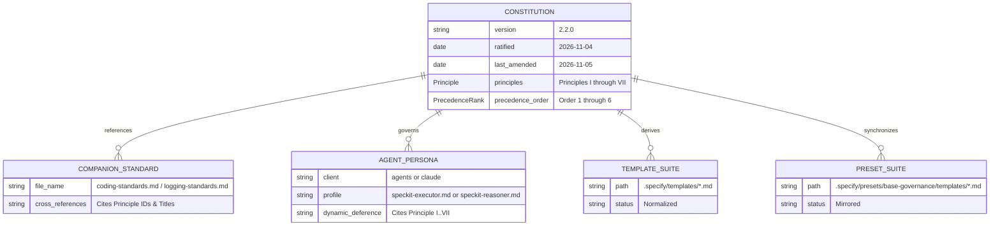

# Data Model: Constitution Modernization Entities & Artifact Hierarchy

**Feature**: `specs/008-precise-constitution-language`  
**Date**: 2026-11-05  

## Governance Artifact Schema

## Entity Invariants

1. **Version Lifecycle**: `.specify/memory/constitution.md` advances from `2.1.0` to `2.2.0`.
2. **Top Amendment Comment**: The HTML header comment in `.specify/memory/constitution.md` tracks only the latest amendment summary (clearing historical accumulation per constitution rules).
3. **Dual Client Parity**: Files in `.agents/agents/` and `.claude/agents/` must have matching byte counts and checksums after edits.
