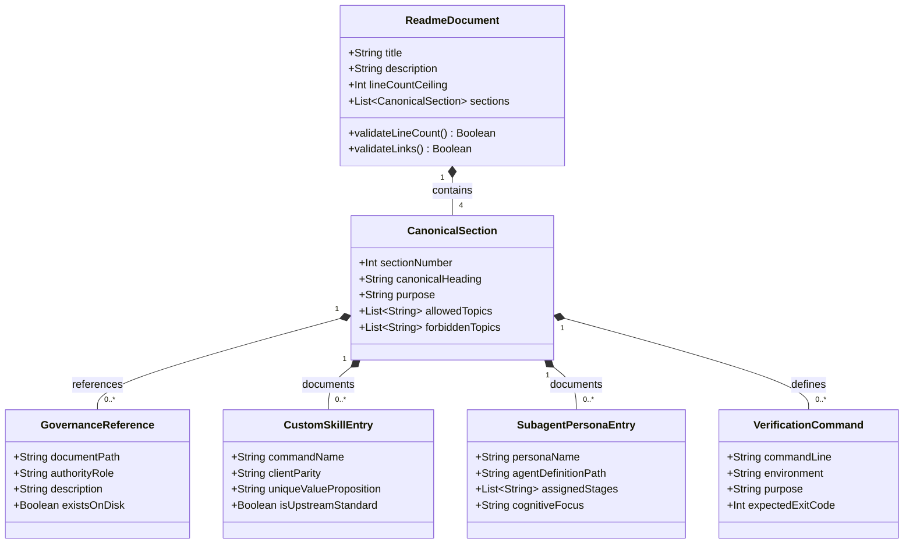

# Data Model: Clean Up README and Focus on Unique Repository Capabilities

**Feature Branch**: `010-clean-readme`  
**Date**: 2026-11-06  
**Status**: Completed  

---

## Conceptual Entities

The README cleanup represents a structured transformation of the human-facing documentation model. The entities below define the schema, constraints, and relationships governing `README.md`.

---

## Entity Definitions

### 1. `ReadmeDocument`
The root documentation artifact (`README.md`).

| Attribute | Type | Description | Validation Rule |
|-----------|------|-------------|-----------------|
| `filePath` | String | Path to document (`README.md`) | Must be repository root |
| `lineCount` | Integer | Total line count of file | Must be $\le 104$ lines ($\ge 25\%$ reduction from 137 lines) |
| `sectionCount` | Integer | Number of top-level canonical sections | Exactly 4 sections |
| `linkIntegrity` | Boolean | Status of relative file paths | 100% of local links must resolve to valid disk paths |

### 2. `CanonicalSection`
Each of the 4 mandatory sections ratified in `.specify/memory/coding-standards.md`.

| Section # | Canonical Heading Title | Purpose & Content | Forbidden Content |
|---|---|---|---|
| **1** | `Project Overview & 4-Tier Architecture` | Purpose, GitHub Spec Kit relationship, 4-tier template fallback hierarchy, dual-client parity. | Redundant command catalogs, speculative architecture. |
| **2** | `Co-Applied Governance Suite` | Summaries and links to `constitution.md`, `coding-standards.md`, and `logging-standards.md`. | Full Principles I–VII table, Optional Modules list (`MODULE-A`–`TRACE`). |
| **3** | `Spec Kit Skills & Subagent Orchestration Reference` | Dual subagent personas (`speckit-reasoner`, `speckit-executor`), custom skills (`/speckit-orchestrate`, `/speckit-bootstrap`, `/speckit-roadmap`), and standard stage governance summary. | Full 12-row table detailing unmodified upstream Spec Kit commands (`specify`, `plan`, `tasks`, etc.). |
| **4** | `Portable Bootstrapping & Verification Quickstart` | Bootstrapper commands (`.sh`, `.ps1`), governance initialization, and static verification check commands (`bash -n`, `diff -r`, `cmp -s`). | Automated unit test commands, non-portable OS commands. |

### 3. `GovernanceReference`
References to authoritative governance files under `.specify/memory/`.

| Attribute | Type | Values / Examples |
|-----------|------|-------------------|
| `documentPath` | String | `.specify/memory/constitution.md`, `.specify/memory/coding-standards.md`, `.specify/memory/logging-standards.md` |
| `version` | String | Semantic version (e.g., `v2.2.0`) |
| `authorityRole` | Enum | `PRIMARY_CONSTITUTION`, `STACK_STANDARDS`, `LOGGING_STANDARDS` |

### 4. `CustomSkillEntry`
Custom skills created specifically by this repository.

| Skill Identifier | Scope | Unique Capability |
|---|---|---|
| `/speckit-orchestrate` | Multi-Agent Coordination | Coordinates context-isolated subagents through clarify, plan, tasks, analyze, implement, and converge with human gates. |
| `/speckit-bootstrap` | Integrity & Upgrades | Verifies file integrity via SHA-256 manifests, detects configuration drift, and performs non-destructive upgrades. |
| `/speckit-roadmap` | Strategic Planning | Authors, visualizes, audits, and syncs project milestones in `ROADMAP.md` directly into feature specifications. |

### 5. `SubagentPersonaEntry`
Subagent personas utilized by `/speckit-orchestrate`.

| Persona | Antigravity Path | Claude Code Path | Assigned Pipeline Stages |
|---|---|---|---|
| `speckit-reasoner` | `.agents/agents/speckit-reasoner.md` | `.claude/agents/speckit-reasoner.md` | `clarify`, `plan`, `analyze`, `converge`, `converge-retry` |
| `speckit-executor` | `.agents/agents/speckit-executor.md` | `.claude/agents/speckit-executor.md` | `specify`, `tasks`, `implement` |

### 6. `VerificationCommand`
Static verification commands documented in Section 4.

| Command | Interpreter | Target | Purpose |
|---|---|---|---|
| `bash -n bootstrap-speckit.sh` | Bash | `bootstrap-speckit.sh` | Verify shell script syntax without execution |
| `diff -r .agents .claude` | diff | `.agents/` vs `.claude/` | Verify 100% byte parity between client configurations |
| `cmp -s <tier4> <tier2>` | cmp | Preset vs core fallback templates | Verify consistency of default and base-governance templates |
