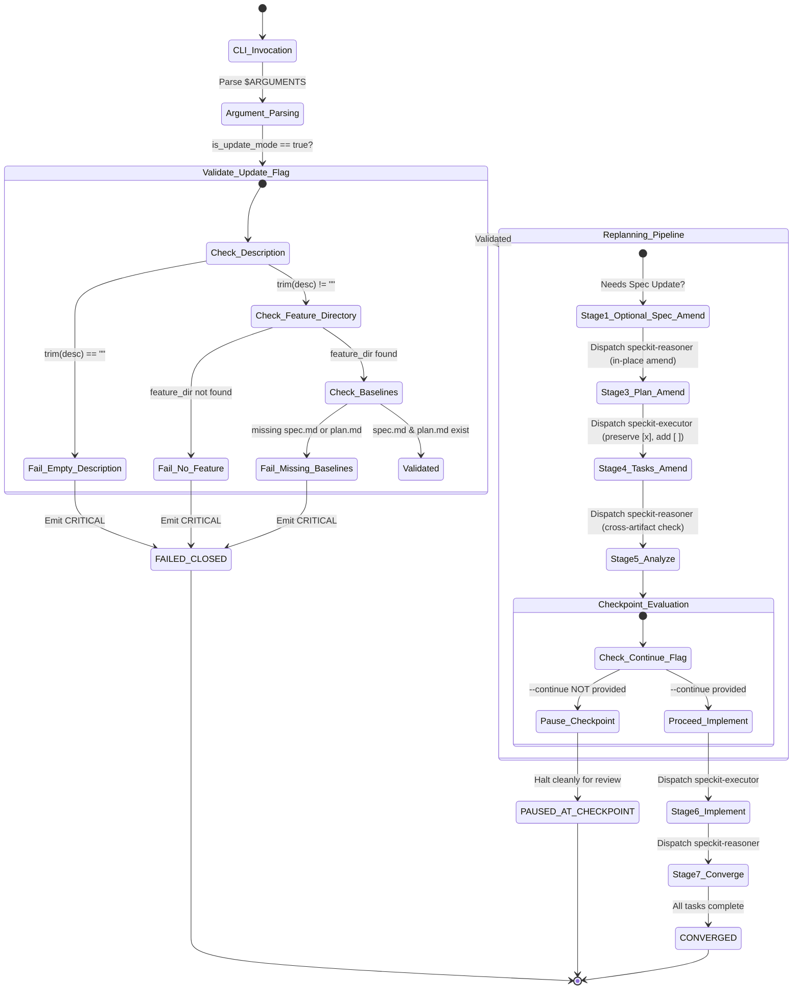

# Data Model: Non-Destructive Architectural Replanning (`--update` / `--amend`)

**Feature**: `011-orchestrate-update-flag`  
**Date**: 2026-11-06  
**Status**: Completed  

---

## 1. Domain Entities & Schemas

### 1.1 Orchestrator Invocation Context (`OrchestratorInvocationContext`)
Represents the parsed execution state and configuration derived from CLI invocation arguments and environment variables.

| Field Name | Type | Description | Validation / Constraints |
|------------|------|-------------|--------------------------|
| `arguments_raw` | `string` | Raw `$ARGUMENTS` passed to orchestrator | None |
| `is_update_mode` | `boolean` | Flag indicating if `--update` or `--amend` was passed | Set to `true` if either flag matches |
| `update_description` | `string` | The extracted natural language description of architectural change | Required if `is_update_mode == true`; trimmed; length > 0; bounding quotes stripped |
| `from_stage` | `StageName?` | Optional stage to start execution from | One of: `specify`, `clarify`, `plan`, `tasks`, `analyze`, `implement`, `converge` |
| `until_stage` | `StageName?` | Optional stage to halt execution after | One of: `specify`, `clarify`, `plan`, `tasks`, `analyze`, `implement`, `converge` |
| `checkpoint_policy` | `CheckpointPolicy` | Pre-implementation pause behavior | `PAUSE_AT_CHECKPOINT` (default) or `CONTINUOUS` (if `--continue` / `--continuous`) |
| `feature_dir` | `string` | Absolute filesystem path to feature directory | Must exist; must contain `spec.md` and `plan.md` if `is_update_mode == true` |
| `rel_feature_dir` | `string` | Project-relative path to feature directory | e.g. `specs/011-orchestrate-update-flag` |
| `session_model_ceiling` | `string` | Resolved LLM model tier | e.g. `high_reasoning` / `standard_execution` |

### 1.2 Feature Design Artifact Set (`FeatureArtifactSet`)
Represents the collection of authoritative planning documents within `SPECIFY_FEATURE_DIRECTORY`.

| Field Name | Path | Update Mode Semantics | Preservation Rule |
|------------|------|-----------------------|-------------------|
| `spec_path` | `${FEATURE_DIR}/spec.md` | Amended in place if requirements change | Retains existing user stories, acceptance criteria, and constitution gates |
| `plan_path` | `${FEATURE_DIR}/plan.md` | Amended in place (Technical Context, Architecture) | Retains baseline decisions, appends update rationale |
| `research_path` | `${FEATURE_DIR}/research.md` | Appended / updated with new architectural findings | Retains prior research findings |
| `data_model_path` | `${FEATURE_DIR}/data-model.md` | Entities and schemas updated/added | Retains existing valid schemas |
| `quickstart_path` | `${FEATURE_DIR}/quickstart.md` | Validation scenarios updated/added | Retains existing validation steps |
| `contracts_dir` | `${FEATURE_DIR}/contracts/` | Interface files added or amended | Existing contracts preserved or updated |
| `tasks_path` | `${FEATURE_DIR}/tasks.md` | Completed tasks preserved; new tasks added | All `- [x]` entries are immutable; pending `- [ ]` adjusted |

### 1.3 Task Item (`TaskItem`)
Represents an individual task entry within `tasks.md`.

| Field Name | Type | Description | State Invariant Under `--update` |
|------------|------|-------------|----------------------------------|
| `id` | `string` | Unique task identifier (e.g. `T001`, `T012`) | Monotonically increasing; never renumbered |
| `title` | `string` | Human-readable action description | Preserved verbatim for completed tasks |
| `status` | `TaskStatus` | `COMPLETED` (`- [x]`) or `PENDING` (`- [ ]`) | **Strict Monotonicity**: Any `- [x]` remains `- [x]`; never reset to `- [ ]` |
| `phase` | `string` | Grouping phase header (e.g. `Phase 1: Setup`) | Existing phases retained; new update phase appended |
| `is_parallel` | `boolean` | `true` if marked `[P]` | Maintained per task |
| `target_files` | `list<string>` | Referenced file paths | Non-overlapping if parallel |

### 1.4 Subagent Stage Directive (`SubagentStageDirective`)
Represents the structured payload dispatched by the orchestrator to a child subagent (`speckit-reasoner` or `speckit-executor`).

| Field Name | Type | Description |
|------------|------|-------------|
| `stage_name` | `StageName` | Lifecycle stage name (`specify`, `clarify`, `plan`, `tasks`, `analyze`, `implement`, `converge`) |
| `target_skill_path` | `string` | Absolute path to skill markdown definition |
| `feature_directory` | `string` | Absolute path to active feature |
| `update_active` | `boolean` | `true` during `--update` runs |
| `update_description` | `string` | Extracted `UPDATE_DESCRIPTION` |
| `stage_instruction` | `string` | Specific non-destructive amendment rules for the current stage |
| `anti_recursion_flag`| `boolean` | `ORCHESTRATOR_CHILD=true` |
| `governance_paths` | `list<string>` | Paths to constitution, coding standards, logging standards |

---

## 2. Validation Rules & Invariants

1. **VR-01: Non-Empty Description Validation**:
   - If `is_update_mode == true` and `trim(update_description) == ""`:
     - Result: Transition to `FAILED_CLOSED` immediately with `CRITICAL` diagnostic.
2. **VR-02: Feature Context Existence**:
   - If `is_update_mode == true` and `feature_dir` cannot be resolved:
     - Result: Transition to `FAILED_CLOSED` immediately with `CRITICAL` diagnostic.
3. **VR-03: Architectural Baseline Existence**:
   - If `is_update_mode == true` and (`spec_path` does not exist OR `plan_path` does not exist):
     - Result: Transition to `FAILED_CLOSED` immediately with `CRITICAL` diagnostic.
4. **VR-04: Task Monotonicity Invariant**:
   - For all `TaskItem` in `tasks.md` where `status == COMPLETED` before an `--update` run:
     - Post-condition: `status` MUST remain `COMPLETED` (`- [x]`), and task line content MUST remain intact.
5. **VR-05: Core Skill Immutability**:
   - `sha256(.agents/skills/speckit-plan/SKILL.md)` and `sha256(.claude/skills/speckit-plan/SKILL.md)` MUST remain unmodified before and after an `--update` run.

---

## 3. State Machine Transitions

